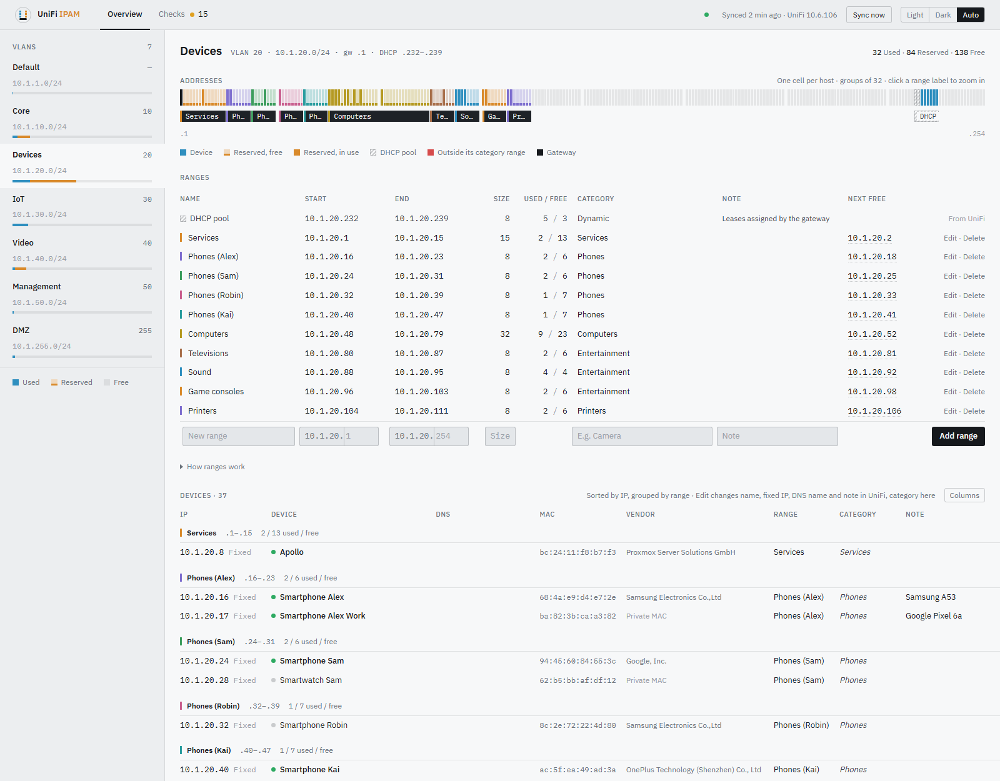
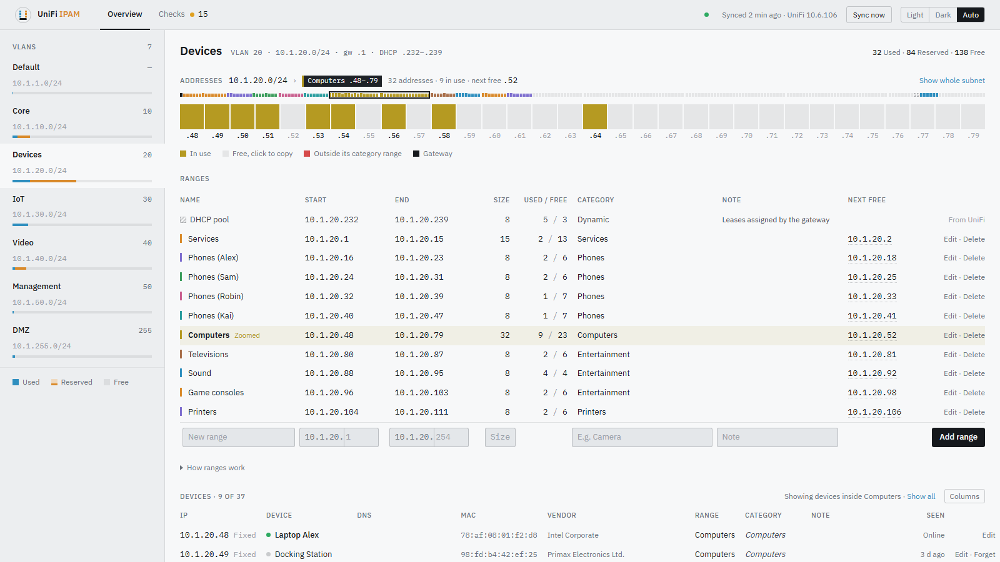
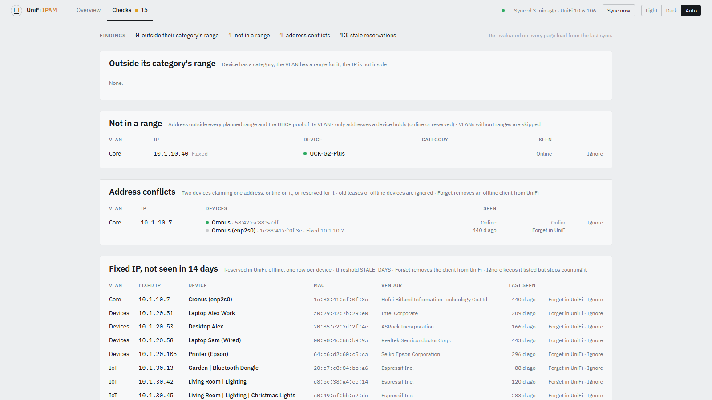

# UniFi IPAM

A small, self-hosted IP address planner for networks routed by a UniFi gateway. It shows every
VLAN as one page: an address strip with one cell per host, the ranges you plan ("cameras get
.16–.31"), and every device UniFi knows about, grouped by range. UniFi stays the source of
truth for devices; this app adds the planning layer UniFi doesn't have.



It is deliberately small: one container, one SQLite file, server-rendered pages, no accounts.
If phpIPAM or NetBox feel like too much for a home or small-office network, this is the
lightweight alternative.

## Features

- **One page per VLAN.** A strip with one cell per address shows devices, planned ranges, the
  DHCP pool and the gateway at a glance. Click a range to zoom in on its addresses.
- **Range planning.** Plan named ranges per VLAN with a category, and see used / free counts and
  the next free address for each. Overlaps are refused, and the DHCP pool is shown as a fixed
  range from UniFi.
- **Devices from UniFi.** Clients and UniFi's own switches and access points, with vendor,
  online state and last seen, sorted by address and grouped by range.
- **Edit in place.** Change a device's name, fixed IP, DNS name and note; they are saved in
  UniFi. Categories are stored in this app, and a device inherits its range's category.
- **Checks.** Find devices outside their category's range or outside any range, two devices
  claiming one address, and fixed-IP devices not seen for a while. Ignore what you accept.
- **Housekeeping.** Forget offline leftovers in UniFi. The app also fills in vendors UniFi doesn't
  know, from the official IEEE registry.
- **Light and dark** themes, a column picker, and a sync that pauses while nobody is looking.

| Zoomed in on one range | Checks |
|---|---|
|  |  |

## Requirements

- A UniFi gateway running the UniFi Network application, such as a UDM, UDM Pro or UCG. It was
  built and tested against a UDM Pro with Network 10.6.106.
- A UniFi API key. Create one under *Settings → Control Plane → Integrations*.
- Docker with Compose, on a machine that can reach the gateway.

## Quick start

```sh
git clone https://github.com/Sandolution/unifi-ipam.git && cd unifi-ipam
cp .env.example .env    # set UNIFI_URL and UNIFI_API_KEY, and VERIFY_TLS=false for a self-signed cert
docker compose up -d --build
```

Open `http://<host>:8000`. The first sync runs at startup and takes about a second.

Then select a VLAN in the left rail and add your first range in the last row of the Ranges
table.

## Configuration

All settings are environment variables, normally set in `.env`.

| Variable | Default | Meaning |
|---|---|---|
| `UNIFI_URL` | | Address of the gateway, for example `https://192.168.1.1` |
| `UNIFI_API_KEY` | | The API key; only ever read from the environment |
| `VERIFY_TLS` | `true` | Set to `false` for the gateway's self-signed certificate |
| `UNIFI_SITE` | `default` | UniFi site name |
| `SYNC_INTERVAL_SECONDS` | `300` | How often to sync from UniFi; `0` turns the background sync off |
| `SYNC_IDLE_MINUTES` | `10` | Pause the sync after this long without an open page; `0` never pauses |
| `STALE_DAYS` | `14` | When a fixed-IP device counts as not seen for too long |
| `DB_PATH` | `/data/ipplan.db` in Docker | SQLite file; Compose keeps it in a named volume |
| `TZ` | `UTC` | Time zone used to show times |

## Using it

**Planning ranges.** Fill the last row of the Ranges table: a name, start, end and optionally a
category. On a /24 subnet you type only the host number. Fill any two of Start, End and Size and
the third is calculated. Ranges must stay inside the subnet and may not overlap each other.
Overlapping the DHCP pool is allowed, with a warning. Click a range to zoom the strip to it.
In the zoomed strip, clicking a free address copies it.

**Devices.** Rows are read-only until you click **Edit**. **Columns** hides the columns you don't
need, and **Forget** removes an offline leftover from UniFi. A grey, italic category is inherited
from the range the device sits in. A small **UniFi** badge marks UniFi's own switches and access
points.

**Checks.** The Checks page lists four kinds of findings, and the count shows in the navigation:

| Check | Finds |
|---|---|
| Outside its category's range | A device whose category has a range in its VLAN, but it sits elsewhere |
| Not in a range | A device holding an address outside every planned range and the DHCP pool |
| Address conflicts | Two devices claiming one address: online on it, or reserved for it |
| Stale reservations | A fixed-IP device offline for longer than `STALE_DAYS` |

**Ignore** keeps a finding listed but stops counting it.

## What it changes in UniFi

The app reads everything, and writes only when you click a button that says so. Every write
asks UniFi to do the same thing its own interface does, for one device at a time.

| Action | What changes in UniFi |
|---|---|
| Save an edited client | Its name, note, fixed IP and local DNS record, only the fields you changed |
| Save a DNS name for a switch or access point | One A record in UniFi's custom DNS records (*Policy table → DNS records*) |
| Forget | Removes an offline client from UniFi, as *Forget* in UniFi does |

Changing or removing a fixed IP asks for confirmation first. A new fixed IP is checked before it
is sent: it must be inside the subnet, must not be the gateway, and must not be held by another
device. If UniFi refuses a change, nothing changes in the app either, and UniFi's reason is
shown.

The app never changes networks, VLANs, the DHCP pool, firewall rules, or the addresses and
settings of UniFi's own devices.

## Security

- **No login.** The app has no authentication of its own. Run it behind a reverse proxy that
  adds authentication, or on a network only you can reach. Anyone who can open the page can
  also make the changes listed above.
- **The API key is powerful.** UniFi API keys carry the rights of the admin who created them.
  Keep `.env` private; it is in `.gitignore`. The key is never written to the database, the logs
  or the pages.
- **Self-signed certificates.** `VERIFY_TLS=false` accepts the gateway's self-signed certificate.
  On a network you don't fully trust, give the gateway a proper certificate and leave it `true`.

## How it works

The app syncs networks, clients, UniFi devices and DNS records from the gateway into SQLite on a
timer. Pages read only from SQLite, so they keep working, with a notice, when the gateway is
unreachable. Planned ranges, categories and ignored findings are stored only in this app.

Every visible page checks in once a minute. After `SYNC_IDLE_MINUTES` without a check-in the sync
pauses, and the header says so. The next page you open syncs straight away and shows fresh data.
A tab you return to after 30 seconds refreshes itself, unless you're in the middle of editing.

The app uses UniFi's internal Network API, the one UniFi's own web interface uses. The official
Integration API doesn't expose fixed IPs, notes or offline clients. The internal API isn't
documented by Ubiquiti and could change in a future UniFi release. All calls to it live in one
file, `app/unifi_adapter.py`, so adapting is contained. What was tested, and how, is in
[docs/unifi-api-findings.md](docs/unifi-api-findings.md).

## Status

Tested against one UDM Pro with UniFi Network 10.6.106, using a single site and about 80
clients.

- **Verified on that controller:** every read; the client update call, sent with unchanged
  values; *Forget*'s command path; and creating, renaming and deleting a custom DNS record.
- **Covered by tests only:** real changes to a client's name, note, fixed IP or DNS name, and
  clearing any of them.
- **Untested:** multiple sites, controllers with many hundreds of clients, and other UniFi
  Network versions.

Reports from other setups are welcome.

## Development

See [docs/development.md](docs/development.md) for running it locally, the tests, the code
layout and how to refresh the test data from your own controller.

## License

MIT, see [LICENSE](LICENSE).

## Not affiliated with Ubiquiti

This is an independent project. UniFi is a trademark of Ubiquiti Inc.
